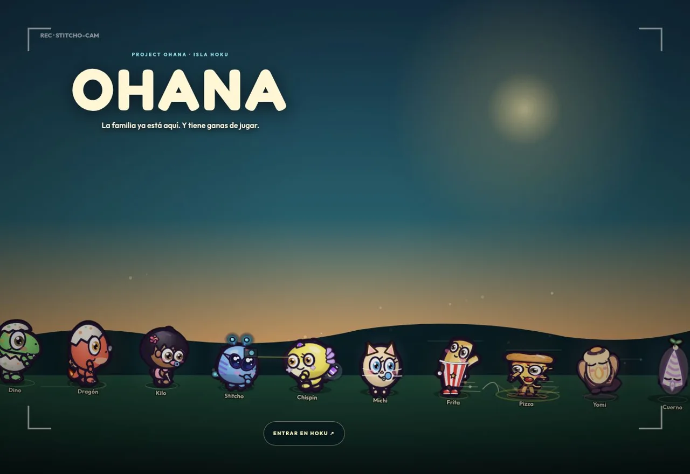
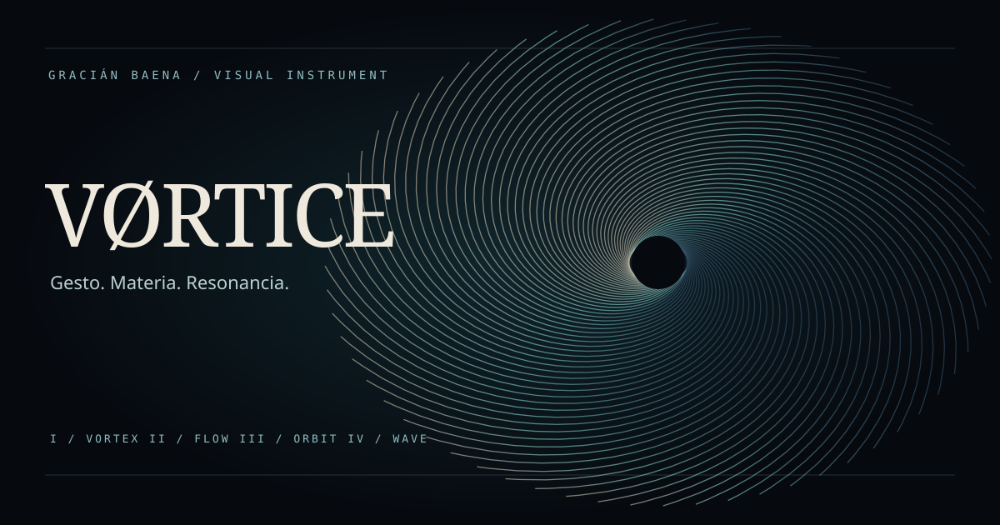
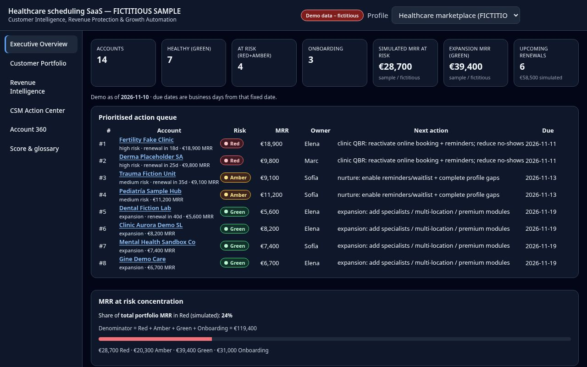

<p align="center">
  <a href="https://gracianb.github.io/systems-lab/"></a>
</p>

<h1 align="center">SYSTEMS LAB</h1>
<p align="center"><strong>Independent tech product studio · Gracián Baena</strong></p>
<p align="center"><em>Software you can explore. Systems you can inspect. Ideas made tangible.</em></p>

<p align="center">
  <a href="https://gracianb.github.io/systems-lab/"><strong>Explore the product showroom ↗</strong></a>
  &nbsp;·&nbsp;
  <a href="#the-product-collection"><strong>Browse products</strong></a>
  &nbsp;·&nbsp;
  <a href="https://gracianb.github.io/professional-deck/"><strong>Professional work ↗</strong></a>
  &nbsp;·&nbsp;
  <a href="https://www.linkedin.com/in/gracianbaena/"><strong>Connect ↗</strong></a>
</p>

---

## From ideas to working products

**Systems Lab is my technology product showcase.** Not a changelog, not a pile of unfinished code, and certainly not a collection of SaaS claims with no product behind them.

I build and explore at the intersection of **applied AI, software engineering, interactive design, creative tools, customer operations and explainable decision systems**. Some creations are public applications you can launch. Others are protected demos, inspectable prototypes, real-world case studies or local-first tools.

Every entry should answer three questions: **What does it do? What can I actually try? What is its real status?**

### The product collection

| Product | What it is | Access |
| :--- | :--- | :--- |
| **[AIGORITMO](#01--aigoritmo--applied-ai--voice)** | Character-driven AI, cloud-first interview lab, local model and voice experiments | [Protected Universe Lab ↗](https://aigoritmo-universe-lab-gracianbs-projects.vercel.app/) · sign-in required |
| **[PROJECT OHANA](#02--project-ohana--interactive-game-world)** | Anime-inspired browser adventure, real-time combat and evolving characters | [Play ↗](https://gracianb.github.io/project-ohana/) · public |
| **[VØRTICE](#03--vrtice--creative-computing)** | Interactive WebGL particle instrument with motion and sound | [Explore ↗](https://vortex-gilt-xi.vercel.app/) · public |
| **[Customer Health Intelligence](#04--customer-health-intelligence--decision-systems)** | Explainable, rules-based CS risk and prioritisation dashboard | [Command Center ↗](https://gracianb.github.io/customer-health-intelligence/) · fictional demo data |
| **[RevOps Studio](#05--revops-studio--operations-engineering)** | Operational workflows, data quality and traceable decisions | [Explore demo ↗](https://gracianb.github.io/revops-studio/demo.html) · fictional demo data |
| **[GuruSup Brain](#06--gurusup-brain--knowledge-governance)** | Knowledge confidence, contradiction handling and responsible support responses | [Read prototype ↗](https://github.com/GracianB/gurusup-brain-demo) · limited-access prototype |
| **[Bodytone Support OS](#07--bodytone-support-os--real-operations)** | Zendesk Help Center and real support-operations work | [Help Center ↗](https://bodytonehelp.zendesk.com/hc/es) · public real-world artifact |
| **[Cutter Studio](#08--cutter-studio--local-creator-tools)** | Local video editing, transcription, subtitles and vertical exports | Private development · no public editor |

**Status matters.** A fictional-data demo is not a connected customer system. A protected showcase is not a public chatbot. A local-first studio is not a hosted SaaS.

---

## Featured experiences

<table>
  <tr>
    <td width="50%" valign="top">
      <a href="https://gracianb.github.io/project-ohana/"></a>
      <p><strong>PLAY / PROJECT OHANA</strong></p>
      <p>A character-driven browser adventure with combat, transformation systems and a growing world. Open the game and feel the engineering behind the animation.</p>
      <p><a href="https://gracianb.github.io/project-ohana/"><strong>Play the game ↗</strong></a></p>
    </td>
    <td width="50%" valign="top">
      <a href="https://vortex-gilt-xi.vercel.app/"></a>
      <p><strong>EXPERIMENT / VØRTICE</strong></p>
      <p>A responsive WebGL audiovisual instrument. Seven movements, evolving particles, reactive controls and procedural sound. This is not a pre-rendered video.</p>
      <p><a href="https://vortex-gilt-xi.vercel.app/"><strong>Enter VØRTICE ↗</strong></a></p>
    </td>
  </tr>
  <tr>
    <td width="50%" valign="top">
      <a href="https://aigoritmo-universe-lab-gracianbs-projects.vercel.app/"></a>
      <p><strong>THINK / AIGORITMO</strong></p>
      <p>Four characters. Two kinds of infrastructure: a private local-first application and a protected FastAPI Cloud Lab. The guided online scenarios are authored scripts, not paid live AI responses.</p>
      <p><a href="https://aigoritmo-universe-lab-gracianbs-projects.vercel.app/"><strong>Open protected lab ↗</strong></a></p>
    </td>
    <td width="50%" valign="top">
      <a href="https://gracianb.github.io/customer-health-intelligence/"></a>
      <p><strong>EXPLAIN / CUSTOMER HEALTH INTELLIGENCE</strong></p>
      <p>See why a customer account may need attention. Inspect scoring rules, risk signals and a prioritised queue using **entirely fictitious sample data**. No predictive ML claim.</p>
      <p><a href="https://gracianb.github.io/customer-health-intelligence/"><strong>Explore the command center ↗</strong></a></p>
    </td>
  </tr>
</table>

---

## 01 · AIGORITMO — Applied AI & voice

**Personality is not the model.** AIGORITMO separates avatars, language providers and voice engines, with Llama, Qwen, Arcana and Arcano as the four featured entry points.

The full application is **local-first** with FastAPI, model options including Ollama, and optional Piper speech. The independent [**Universe Lab**](https://aigoritmo-universe-lab-gracianbs-projects.vercel.app/) is a **protected Vercel deployment** of a stateless FastAPI showcase with 24 guided character × scenario × language examples. Guided answers are written examples; they do **not** call an AI provider. Remote GPT and ElevenLabs TTS are optional and **disabled by default**. The separate ElevenLabs-hosted voice agent does not control the local app.

**Built with:** Python · FastAPI · JavaScript/TypeScript · local inference · OpenAI API integration · ElevenLabs/Piper speech.

## 02 · PROJECT OHANA — Interactive game world

An evolving browser game with anime-influenced characters, powers, movement, real-time combat and connected places in Isla Hoku. The project README currently documents **12 characters × 5 forms** and an expanding campaign. Here you can explore the experience rather than read about an imaginary game engine.

**Built with:** JavaScript · Canvas · state-driven gameplay · accessible controls · automated checks.  
[**Play OHANA ↗**](https://gracianb.github.io/project-ohana/) · [Source ↗](https://github.com/GracianB/project-ohana)

## 03 · VØRTICE — Creative computing

An interactive audiovisual field built with **WebGL**, not a static artwork. Seven movement modes, particle dynamics, visual presets and optional audio react to the visitor. The implementation documents up to **32,000 particles**, responsive performance adaptation and browser capture.

**Built with:** WebGL · React · TypeScript · Web Audio.  
[**Launch VØRTICE ↗**](https://vortex-gilt-xi.vercel.app/) · [Source ↗](https://github.com/GracianB/vortex)

## 04 · Customer Health Intelligence — Decision systems

A rules engine and Command Center for understanding account health, retention risk, adoption signals and next actions. Every prioritisation is **explainable**. It is not trained on production churn data and does **not** use real accounts. The displayed customer data, money and sector profiles are fictitious; Slack is not connected.

**Built with:** JavaScript · rule-based analytics · browser UI · optional n8n workflow.  
[**Open the Command Center ↗**](https://gracianb.github.io/customer-health-intelligence/) · [Source ↗](https://github.com/GracianB/customer-health-intelligence)

## 05 · RevOps Studio — Operations engineering

A public demonstration of process design, CSV data quality, operational decision rules, scenario comparisons and human review. The [broader RevOps Studio](https://gracianb.github.io/revops-studio/) presents independent services; the technical control room is a **fictional/sample-data simulation**, not an active CRM or ERP.

**Built with:** browser JavaScript · inspectable rules · data validation · workflow design.  
[**Try the Control Room ↗**](https://gracianb.github.io/revops-studio/demo.html) · [Source ↗](https://github.com/GracianB/revops-studio)

## 06 · GuruSup Brain — Knowledge governance

A support-focused prototype for a deceptively difficult question: **what should an assistant do when the sources disagree, are missing, or are out of date?** It explores citations, ambiguity and the point at which a human should decide.

A **prototype with limited access**, not a GuruSup-owned or production support system. Public documentation is available; interactive access is not promised.  
[**Read the prototype ↗**](https://github.com/GracianB/gurusup-brain-demo)

## 07 · Bodytone Support OS — Real operations

My work on customer support operations around Zendesk, service knowledge and the Help Center. The **public support portal is a real artifact**. The case does not expose private tickets, customer accounts or internal metrics.

[**View the public Help Center ↗**](https://bodytonehelp.zendesk.com/hc/es) · [Professional case ↗](https://gracianb.github.io/professional-deck/proyecto-bodytone.html)

## 08 · Cutter Studio — Local creator tools

A private/local creator environment for video projects, transcription, editable subtitles and exported vertical clips. The engineering work exists in its own repository, but **there is no public online editor** to launch from this page. That's a deliberate boundary, not a broken link.

---

## The thread connecting the products

I came to software through **Customer Success, SaaS and operations**. Working alongside technical teams made me want to build, not only explain, the tools that users depend on.

That curiosity grew into local AI experiments, browser games, reactive visuals, explainable decision engines and creator tooling. Different products, one method:

**Understand a real problem → design an interaction → build the smallest useful system → test it → make its limitations clear.**

### How to explore Systems Lab

The [**public product showroom**](https://gracianb.github.io/systems-lab/) has an **ES / EN** language switch, dark and light themes, searchable product cards and access labels. The page uses static HTML for the catalog, with lightweight JavaScript enhancements for filters and interactions.

| Access label | What it actually means |
| --- | --- |
| **Public experience** | A visitor can open an interactive project. |
| **Sample-data demo** | The interface works, but operational records and outcomes are fictional. |
| **Protected cloud demo** | You need authorised access; the showcase may use prepared examples, not live paid AI. |
| **Limited-access prototype** | The concept and documentation can be inspected; interactive access is not guaranteed. |
| **Private development** | Local or unpublished software with no public application link. |

### Development quality

This repository is the **showcase site**, not the complete source of every product. Each product is developed separately. Here the build protects links, assets, accessibility, performance and static publishing.

```bash
npm ci
npm run check
npm run test:browser
npm run build
```

**Source of truth:** individual product repositories for implementation and validation; this site for discovery and transparent product status. GitHub Pages deploys from the verified build. No credentials, private customer records or local models belong in this repository.

---

### En español

**Systems Lab es mi escaparate de productos tecnológicos.** Aquí puedes descubrir aplicaciones de IA, experiencias interactivas, juegos, software creativo y sistemas para Customer Success. Cada proyecto indica si es público, una demo con datos ficticios, un prototipo limitado o un desarrollo privado.

[**Entrar en Systems Lab ↗**](https://gracianb.github.io/systems-lab/) · [**Ver mi trayectoria profesional ↗**](https://gracianb.github.io/professional-deck/)

<p align="center"><strong>Built to be used. Designed to be understood.</strong></p>
<p align="center"><a href="https://github.com/GracianB">GitHub</a> · <a href="https://www.linkedin.com/in/gracianbaena/">LinkedIn</a> · <a href="https://gracianb.github.io/GracianB/">Personal hub</a></p>
