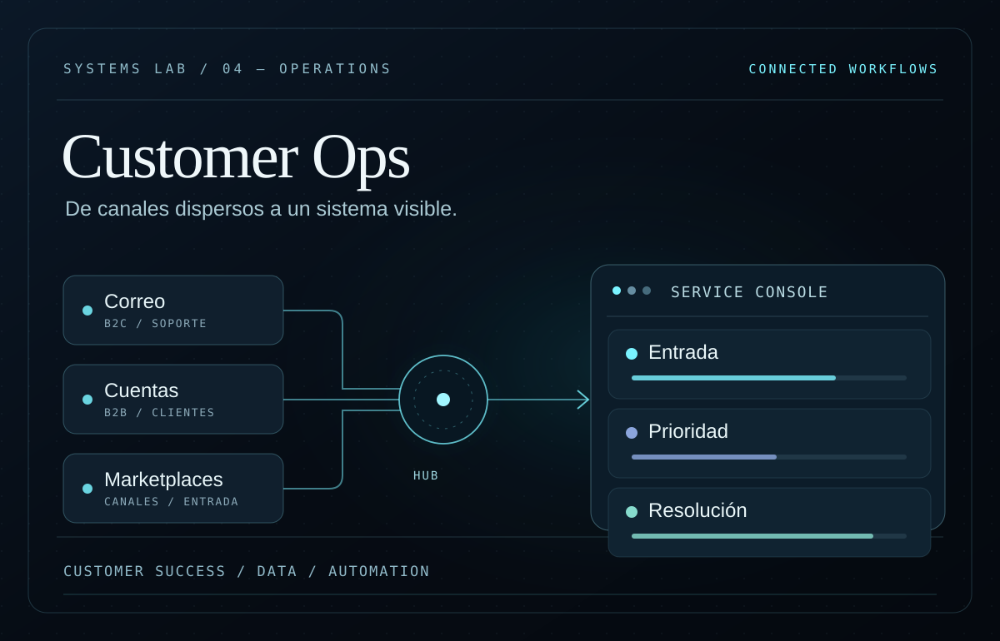

<h1 align="center">Systems Lab · Product Studio</h1>
<h3 align="center">Applied AI · Games · Creative Computing · Operational Systems</h3>

<strong>Software you can explore. Systems you can understand.</strong>

<a href="https://gracianb.github.io/systems-lab/"><strong>Enter the product showroom ↗</strong></a> &nbsp;·&nbsp; <a href="https://gracianb.github.io/professional-deck/"><strong>Professional Deck ↗</strong></a> &nbsp;·&nbsp; <a href="https://www.linkedin.com/in/gracianbaena/"><strong>Connect ↗</strong></a>

---

## Seven products. Real interfaces. Clear boundaries.

**Systems Lab is my technology product showcase.** I build software at the intersection of applied AI, interactive design, creative tools, customer operations and explainable decisions.

Some creations are **public and playable**; others use **fictional data**, require authentication or run only on my machine. Systems Lab itself is **not an online chat**. Every product explains what works, where to try it and what remains private.

<table>
<tr>
<td width="50%" valign="top">

<h3><a href="https://gracianb.github.io/project-ohana/">01 · PROJECT OHANA ↗</a></h3>

<strong>PUBLIC / PLAY.</strong> A Canvas adventure with powers, real-time combat and evolving characters. The current game repo documents **12 characters and 60 forms**. [Explore the live character gallery ↗](https://gracianb.github.io/project-ohana/gallery.html). This illustration represents the current roster; the gallery is rendered from the game code.

</td>
<td width="50%" valign="top">

<h3><a href="https://vortex-gilt-xi.vercel.app/">02 · VØRTICE ↗</a></h3>

<strong>PUBLIC / EXPERIMENT.</strong> A reactive WebGL particle instrument: seven movements, dynamic physics and generative sound. Not a pre-rendered video.

</td>
</tr>
</table>

<table>
<tr>
<td width="50%" valign="top">

<h3><a href="https://aigoritmo-universe-lab-gracianbs-projects.vercel.app/">03 · AIGORITMO ↗</a></h3>

<strong>PROTECTED / THINK.</strong> A private/local AI application with Ollama and Piper options, plus a protected FastAPI Cloud Lab. Its 24 guided examples are scripted; GPT and ElevenLabs paid calls are disabled by default.

</td>
<td width="50%" valign="top">

<h3><a href="https://gracianb.github.io/customer-health-intelligence/">04 · CUSTOMER HEALTH INTELLIGENCE ↗</a></h3>

<strong>PUBLIC DEMO / EXPLAIN.</strong> Account risk, adoption and next actions from a rules-based Command Center. All customer profiles and monetary figures are fictional data, not real accounts.

</td>
</tr>
</table>

## More products in the lab

  

*Editorial workflow illustrations, not screenshots of deployed customer systems.*

**05 · [RevOps Studio ↗](https://gracianb.github.io/revops-studio/demo.html)** · *Sample-data demo*  
Operational workflows, CSV quality, explainable decision rules and human review. No production CRM or ERP connection.

**06 · [Bodytone Support OS ↗](https://bodytonehelp.zendesk.com/hc/es)** · *Real CUSTOMER OPERATIONS case*  
A public Zendesk Help Center and operational knowledge work. Private support tickets are not exposed. [Professional case ↗](https://gracianb.github.io/professional-deck/proyecto-bodytone.html).

**07 · Cutter Studio** · *Private local creator tool*  
Video projects, transcription, editable captions and vertical exports. No public online editor or misleading launch link.

---

## The ideas behind the work

My path started in **SaaS Customer Success and operations**. Working with technical teams inspired me to learn how to build the products I used to explain.

**The approach:** understand a real need → design a useful interaction → ship a testable system → explain its boundaries.

| Public experience | Sample-data demo | Protected preview | Private build |
| :--- | :--- | :--- | :--- |
| Open and interact. | Working simulation, fictional records. | Authorised access; examples may be scripted. | Local or unpublished software. |

**Stack across projects:** Python / FastAPI · JavaScript / TypeScript · Canvas · WebGL · local AI · API integrations · speech · data validation · automated browser testing.

**This repository is the public showroom**, not the full source of every project. No customer records, keys or local conversations are published. Static password gates are not server-side authentication; protected demos use the appropriate hosting controls.

## Explore further

The [**live Systems Lab**](https://gracianb.github.io/systems-lab/) includes ES / EN, dark and light themes, product search and filters. Quality checks precede GitHub Pages deployment.

[**Architecture**](docs/ARCHITECTURE.md) · [**Quality & boundaries**](docs/QUALITY_AND_BOUNDARIES.md) · [**Release notes**](docs/RELEASES.md) · [**GitHub configuration**](docs/GITHUB_CONFIGURATION.md)

**Connected universes:** [Professional Deck](https://gracianb.github.io/professional-deck/) · [Yoga Instructor](https://gracianb.github.io/yoga-instructor/) · [Personal hub](https://gracianb.github.io/GracianB/)

**En español:** Systems Lab es mi escaparate de productos tecnológicos: IA, videojuegos, software creativo y herramientas para operaciones, con accesos y límites reales.

<strong>Build thoughtfully. Show the product. Let people explore.</strong>

<a href="https://github.com/GracianB">GitHub</a> · <a href="https://www.linkedin.com/in/gracianbaena/">LinkedIn</a>

