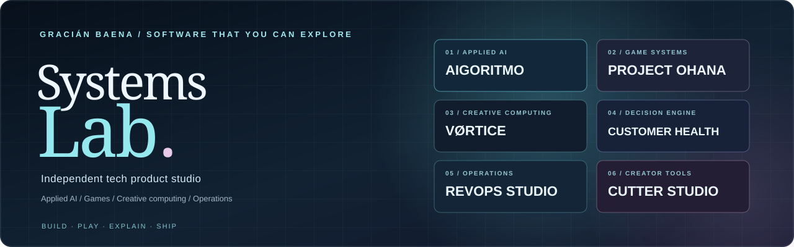
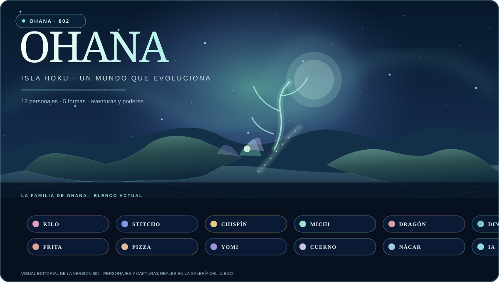
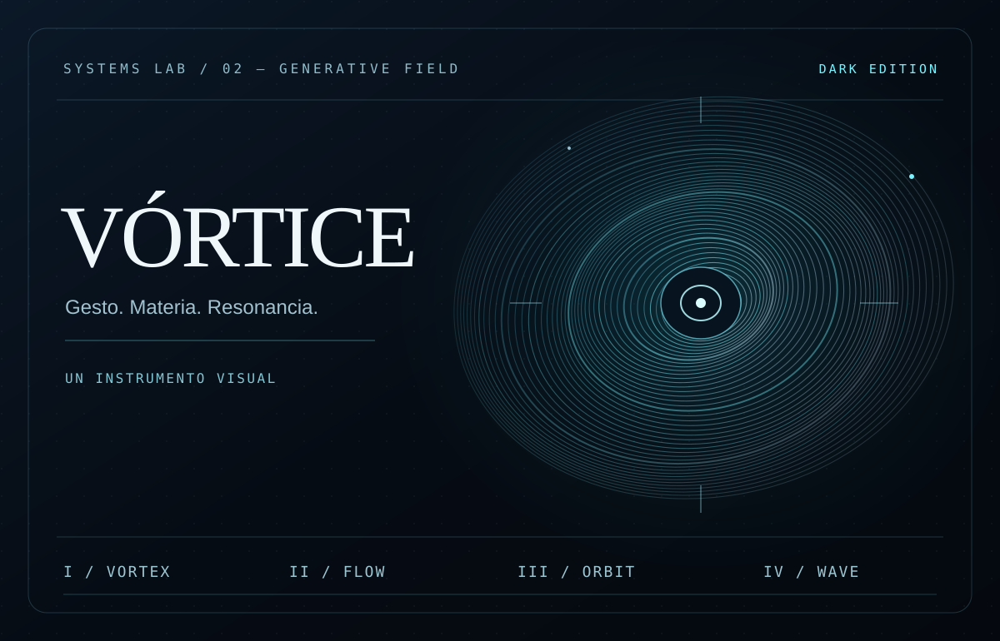
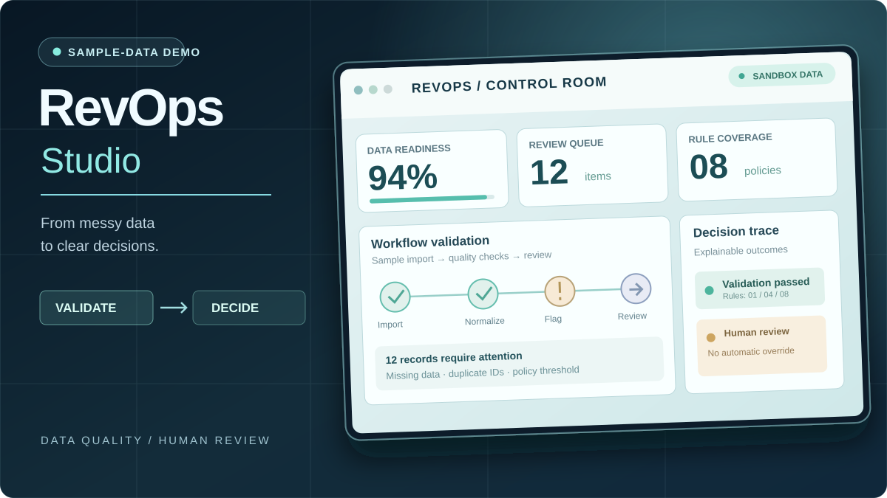
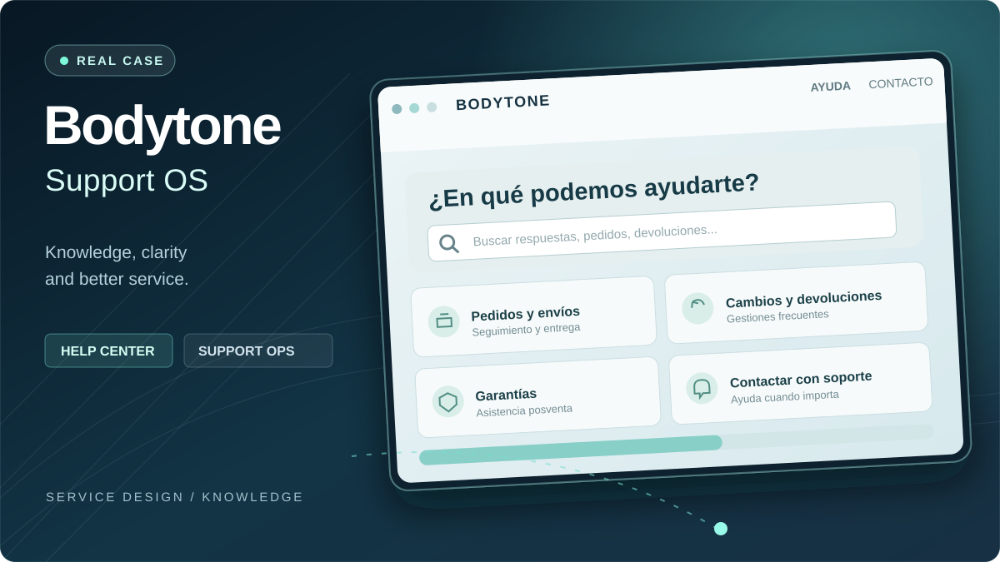
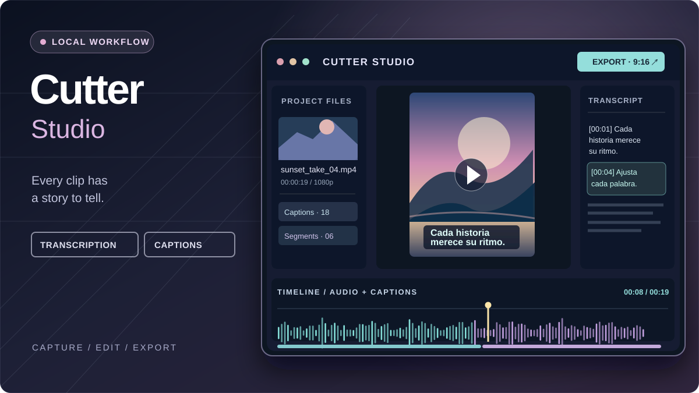

  

<h1 align="center">SYSTEMS LAB</h1>

<strong>Independent technology product studio · Gracián Baena</strong>

<em>Applied AI · Interactive worlds · Creative computing · Decision systems</em>

A place to <strong>explore real software</strong>, understand what it does, and discover the thinking behind it.

  <a href="https://gracianb.github.io/systems-lab/"><strong>EXPLORE THE LIVE SHOWROOM ↗</strong></a>
  &nbsp; · &nbsp;
  <a href="https://gracianb.github.io/professional-deck/"><strong>PROFESSIONAL DECK ↗</strong></a>
  &nbsp; · &nbsp;
  <a href="https://www.linkedin.com/in/gracianbaena/"><strong>CONNECT ↗</strong></a>

7 PRODUCTS & EXPERIENCES &nbsp; / &nbsp; ENGLISH + ESPAÑOL &nbsp; / &nbsp; PUBLIC, DEMO & PRIVATE WORK

---

## Ideas that become experiences

**Systems Lab is a product showcase, not a repository changelog.** I build at the intersection of software, AI, playful interaction and customer operations. My background in SaaS and Customer Success shaped one rule: a product should be useful, understandable and honest about what it can do.

Every project has a purpose, an interaction and a clear access level. Some are **playable online**; others use **fictional demonstration data**, need authentication or run only on a local machine. Systems Lab itself is **not an online chat** or hosted AI service.

**Start exploring:** [AI universe](#01--aigoritmo--the-ai-universe) · [Playable worlds](#02--03--interactive-worlds) · [Decision systems](#04--05--intelligence--operations) · [Real-world craft](#06--07--support--creator-tools)

---

## 01 · AIGORITMO / The AI universe

**Four identities. Different ways to think, talk and create.**

AIGORITMO is a character-driven AI experiment with an avatar selector: **Llama** and **Qwen** for model-based conversations; **Arcana** and **Arcano** for a separate tarot salon. The salon and the language/voice providers are distinct parts of the architecture.

<table>
<tr>
<td width="50%" valign="top" align="center">
  
  
<strong>ARCANA</strong> · Tarot salon

</td>
<td width="50%" valign="top" align="center">
  
  
<strong>ARCANO</strong> · Tarot salon

</td>
</tr>
</table>

<strong>LLAMA</strong> · <strong>QWEN</strong> · <strong>ARCANA</strong> · <strong>ARCANO</strong>

The local-first application explores **FastAPI, Ollama model options and Piper speech**. Its separate [**protected Universe Lab**](https://aigoritmo-universe-lab-gracianbs-projects.vercel.app/) lets authorised visitors explore **24 guided character/scenario/language examples** without relying on my PC. These examples are **authored scripts**, not live paid AI completions. OpenAI and ElevenLabs integrations are optional, require separate configuration and are **off by default**.

<a href="https://aigoritmo-universe-lab-gracianbs-projects.vercel.app/"><strong>ENTER THE PROTECTED AI LAB ↗</strong></a>

---

## 02–03 · Interactive worlds

<table>
<tr>
<td width="50%" valign="top">
  
  <h3><a href="https://gracianb.github.io/project-ohana/">02 · PROJECT OHANA ↗</a></h3>
  
<strong>PUBLIC EXPERIENCE / PLAY</strong>

  
An anime-inspired Canvas adventure built around movement, powers, transformations and real-time combat. The documented world includes <strong>12 characters, five forms each</strong>, a ten-room campaign and an additional underwater chapter.

  
<a href="https://gracianb.github.io/project-ohana/gallery.html"><strong>Meet the characters ↗</strong></a> · <a href="https://github.com/GracianB/project-ohana">Source &amp; evidence ↗</a>

</td>
<td width="50%" valign="top">
  
  <h3><a href="https://vortex-gilt-xi.vercel.app/">03 · VØRTICE ↗</a></h3>
  
<strong>PUBLIC EXPERIENCE / EXPERIMENT</strong>

  
An interactive audiovisual instrument, not a rendered video. Explore <strong>seven motion systems, eleven visual presets</strong>, responsive particles and generative sound. Capture a still or a WebM recording directly from the experience.

  
<a href="https://vortex-gilt-xi.vercel.app/"><strong>Launch VØRTICE ↗</strong></a> · <a href="https://github.com/GracianB/vortex">Source &amp; controls ↗</a>

</td>
</tr>
</table>

---

## 04–05 · Intelligence & operations

<table>
<tr>
<td width="50%" valign="top">
  
  <h3><a href="https://gracianb.github.io/customer-health-intelligence/">04 · CUSTOMER HEALTH INTELLIGENCE ↗</a></h3>
  
<strong>PUBLIC DEMO / EXPLAIN</strong>

  
Configurable, <strong>rules-based</strong> health scoring for customer teams: risk, adoption, revenue exposure and suggested next actions. Compare conceptual healthcare, real estate and pricing-SaaS scenarios. <strong>All customer data and monetary figures are fictitious.</strong>

  
<a href="https://gracianb.github.io/customer-health-intelligence/"><strong>Explore the Command Center ↗</strong></a> · <a href="https://github.com/GracianB/customer-health-intelligence">Source &amp; scoring rules ↗</a>

</td>
<td width="50%" valign="top">
  
  <h3><a href="https://gracianb.github.io/revops-studio/demo.html">05 · REVOPS STUDIO ↗</a></h3>
  
<strong>PUBLIC DEMO / OPERATE</strong>

  
Turn a messy operational process into an inspectable one. Try <strong>CSV data-quality checks, decision rules, scenario comparison, audit trails</strong> and human review. The demonstration uses <strong>sample data</strong>, without live CRM or ERP connections.

  
<a href="https://gracianb.github.io/revops-studio/demo.html"><strong>Try the Control Room ↗</strong></a> · <a href="https://github.com/GracianB/revops-studio">Source &amp; workflows ↗</a>

</td>
</tr>
</table>

---

## 06–07 · Support & creator tools

<table>
<tr>
<td width="50%" valign="top">
  
  <h3><a href="https://bodytonehelp.zendesk.com/hc/es">06 · BODYTONE SUPPORT OS ↗</a></h3>
  
<strong>REAL PROFESSIONAL CASE / CUSTOMER OPERATIONS</strong>

  
Work on the service experience: a public <strong>Zendesk Help Center</strong>, support knowledge and customer-operations processes. The portal is a real public artifact; private tickets and customer information are not part of this showcase.

  
<a href="https://bodytonehelp.zendesk.com/hc/es"><strong>View the Help Center ↗</strong></a> · <a href="https://gracianb.github.io/professional-deck/proyecto-bodytone.html">Read the professional case ↗</a>

</td>
<td width="50%" valign="top">
  
  <h3>07 · CUTTER STUDIO</h3>
  
<strong>PRIVATE DEVELOPMENT / CREATE</strong>

  
A local-first creative workflow for <strong>video transcription, editable subtitles</strong> and vertical clip export. An unpublished tool in development, <strong>not a public online editor</strong>. No invented demo or launch link.

  
Local tool · Private development · No public customer data

</td>
</tr>
</table>

Product graphics are illustrations unless explicitly described as screenshots. Public cases and sample-data demos are identified separately.

---

## One studio, three connected disciplines

| DESIGN INTERACTIONS | ENGINEER SYSTEMS | EXPLAIN DECISIONS |
| :--- | :--- | :--- |
| Characters, motion, interfaces and creative tools that invite exploration. | Python / FastAPI, TypeScript / JavaScript, Canvas, WebGL, API integrations and local-first workflows. | Customer Success, service operations, data validation, dashboards and traceable rules. |

I came to software through **international SaaS Customer Success**. Supporting people using technical products made me curious about how to build those products myself. Today I connect **product thinking, engineering and real operational needs**.

### How I work

**Understand → prototype → implement → test → make the limitations visible.** A good demo should show what is actually implemented, not simply make a claim sound impressive.

The showroom is a lightweight, bilingual **ES/EN static site** with product discovery, accessible navigation, dark/light themes and reduced-motion support. Automated checks run across **Chromium, Firefox and WebKit** and produce visual comparisons. Each larger product has its **own repository and delivery lifecycle**.

### What visitors can access

- **Public:** live experiences such as OHANA and VØRTICE.
- **Sample-data demos:** functioning interfaces, fictional data and simulated operational records, no live customer integrations.
- **Protected cloud preview:** authenticated entry, with scripted scenarios clearly separated from paid AI.
- **Private/local:** documented concepts or workflows without a public launch link.

---

## Explore the ecosystem

**[Systems Lab ↗](https://gracianb.github.io/systems-lab/)** · The product showroom  
**[Professional Deck ↗](https://gracianb.github.io/professional-deck/)** · Career, Customer Success and real work  
**[Yoga Instructor ↗](https://gracianb.github.io/yoga-instructor/)** · A separate universe around movement and teaching

<strong>For developers · Architecture, tests and publication</strong>

The public site is static and intentionally does **not** contain the private implementation of AIGORITMO, operational customer data or secrets. Development commands and workflow internals are kept in the technical documentation, not the product storefront.

Read the [architecture](docs/ARCHITECTURE.md), [quality and security boundaries](docs/QUALITY_AND_BOUNDARIES.md), [release decisions](docs/RELEASES.md) and [GitHub configuration](docs/GITHUB_CONFIGURATION.md). The GitHub Pages deployment and the product demos are independently verified; passing source tests alone is not proof that every external service is online.

---

**En español:** Systems Lab es mi escaparate independiente de productos tecnológicos. Encontrarás IA conversacional, videojuegos, diseño interactivo y herramientas para operaciones. Cada experiencia distingue entre aplicación pública, demo con datos ficticios, entorno protegido y desarrollo privado.

<strong>Build with purpose. Design for people. Make it real.</strong>

<a href="https://gracianb.github.io/systems-lab/">Explore Systems Lab</a> · <a href="https://github.com/GracianB">GitHub</a> · <a href="https://www.linkedin.com/in/gracianbaena/">LinkedIn</a>

