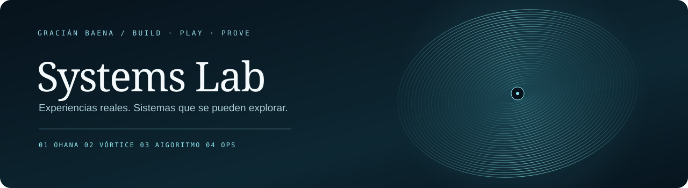
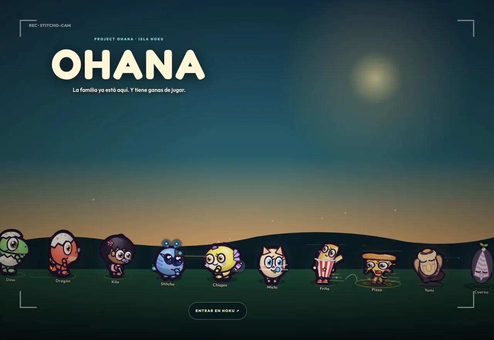
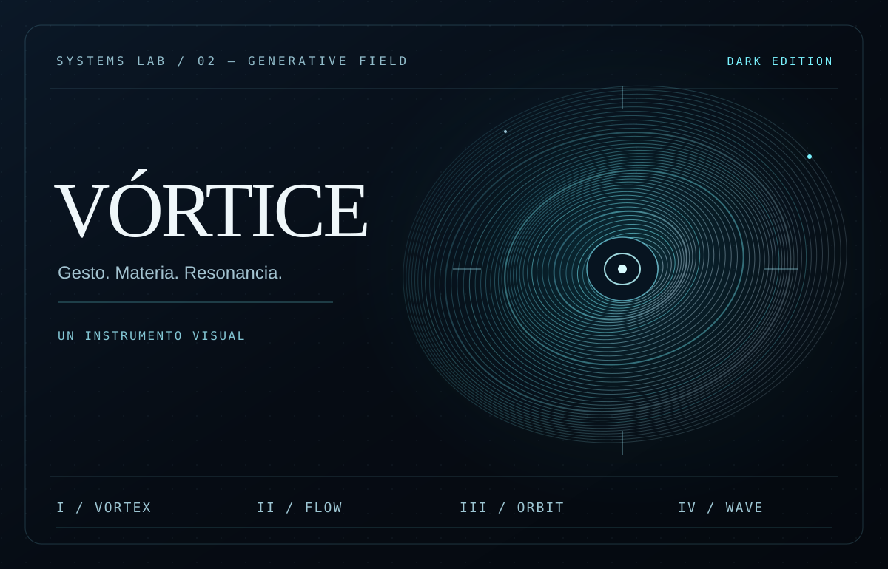
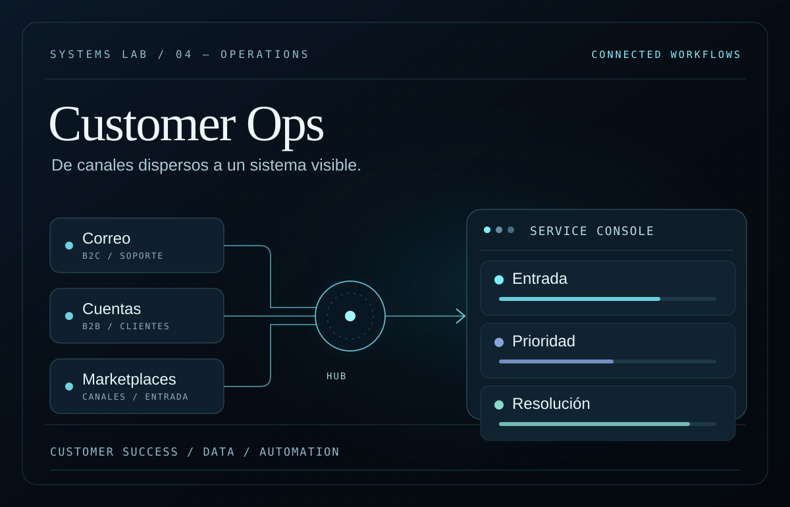

  

<h1 align="center">Systems Lab · Gracián Baena</h1>

<h3 align="center">Play · Experiment · Understand · Build</h3>

<strong>An interactive universe where software ideas become things you can actually explore.</strong>

<a href="https://gracianb.github.io/systems-lab/"><strong>Enter Systems Lab ↗</strong></a> &nbsp;·&nbsp; <a href="https://gracianb.github.io/GracianB/"><strong>Open the personal hub ↗</strong></a> &nbsp;·&nbsp; <a href="https://gracianb.github.io/professional-deck/"><strong>Explore Professional Deck ↗</strong></a>

---

## Four doors. Four ways to explore.

Systems Lab connects game design, real-time visuals, local AI experiments and the operations work that inspired my journey into software.

Not everything is the same kind of product. Some experiences are fully public, some are **showcases of software that runs locally**, and some are **demonstrations with fictional data**. That distinction is part of the design, not a footnote.

<table>
<tr>
<td width="50%" valign="top">

<h3><a href="https://gracianb.github.io/project-ohana/">01 · PROJECT OHANA ↗</a></h3>

<strong>Play.</strong> Explore a browser-based game with character evolution, movement, worlds and changing systems. A public creative-engineering project, under active iteration.

</td>
<td width="50%" valign="top">

<h3><a href="https://vortex-gilt-xi.vercel.app/">02 · VØRTICE ↗</a></h3>

<strong>Experiment.</strong> A responsive WebGL field with four movements, curated visual states, pointer interaction and optional sound. A public interactive experience.

</td>
</tr>
</table>

<table>
<tr>
<td width="50%" valign="top">

<h3><a href="https://gracianb.github.io/systems-lab/#aigoritmo">03 · AIGORITMO ↗</a></h3>

<strong>Discover.</strong> Llama, Qwen, Arcana and Arcano are four identities inside a private/local AI application. This page is an illustrated showcase, <strong>not</strong> an online chat you can use.

</td>
<td width="50%" valign="top">

<h3><a href="https://gracianb.github.io/systems-lab/#cs">04 · CUSTOMER OPERATIONS ↗</a></h3>

<strong>Understand.</strong> Explore a real support-operations context alongside a clearly marked local simulation using fictional requests and outcomes.

</td>
</tr>
</table>

## A bridge between people and technology

I came to software through Customer Success and operations: customer journeys, knowledge, support workflows, data quality and the moments where people need a tool to make sense.

Systems Lab asks a related question: **what happens when those ideas become interactive systems?**

That can mean a browser game with evolving states, a field of thousands of responsive particles, an AI conversation with a distinct identity or an explainable support workflow.

The goal is not to claim every prototype is a finished SaaS product. It is to make the design choices, interaction and boundaries visible.

## More to investigate

**[Customer Health Intelligence · Live Command Center](https://gracianb.github.io/customer-health-intelligence/)**  
Rules-based CS/RevOps health scoring with a public Command Center. Demo data is fictitious; sector cases are conceptual and the named companies do not use this system. [Source repository](https://github.com/GracianB/customer-health-intelligence).

**[RevOps Studio · Public sample-data demo](https://gracianb.github.io/revops-studio/demo.html)**  
Operational decision logic, data quality, scoring and traceability. This is a simulation, not access to a real customer environment.

**[GuruSup Brain · Knowledge confidence prototype](https://gracianb.github.io/systems-lab/gurusup-brain/)**  
A small experiment in what an assistant should do when sources are missing, outdated or contradictory.

**Cutter Studio · Local video creator (private)**  
An experimental desktop/local workflow for clips and captions. There is no public editor service to launch from this site.

## How to explore

Open the [**live Systems Lab**](https://gracianb.github.io/systems-lab/) and choose a door. The experience offers English and Spanish content, light and dark themes and a quick navigator with keyboard search. External projects open on their own websites; some content is an illustrative project showcase only.

No account is required to visit the public laboratory. Private model files, keys, local conversations and unreleased applications are not part of the public showcase.

## Connected universes

The other two worlds are intentionally different expressions of the same curiosity:

[**Professional Deck**](https://gracianb.github.io/professional-deck/) · People, operations, systems and real-world evidence  
[**Yoga Instructor**](https://gracianb.github.io/yoga-instructor/) · Presence, movement and teaching

---

<strong>Build carefully. Explain clearly. Let people explore.</strong>

<a href="https://gracianb.github.io/systems-lab/"><strong>Systems Lab</strong></a> &nbsp;·&nbsp; <a href="https://github.com/GracianB"><strong>GitHub profile</strong></a> &nbsp;·&nbsp; <a href="https://gracianb.github.io/GracianB/"><strong>Personal hub</strong></a>

